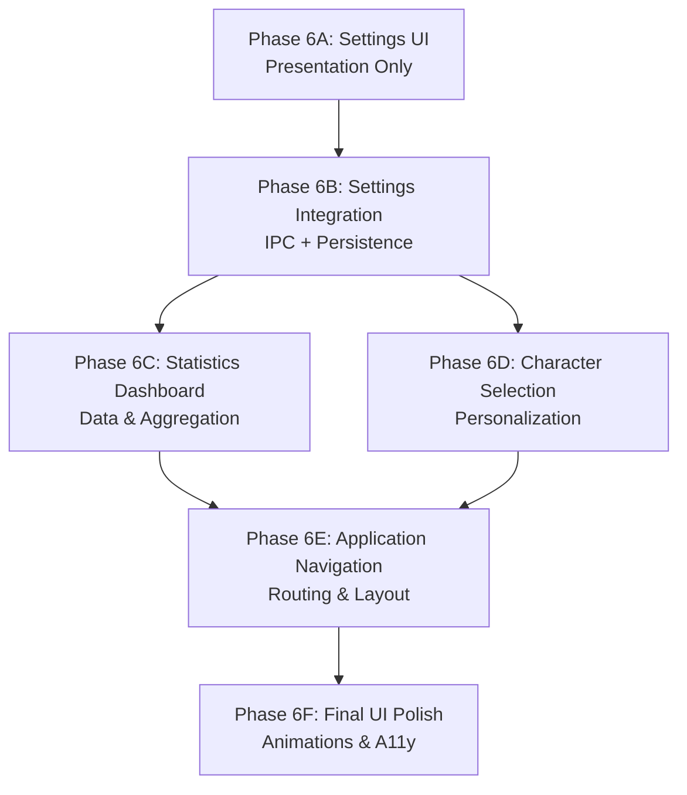

# AquaTick Phase 6 Architecture & Implementation Roadmap

## Overview
Phase 6 focuses on the user-facing configuration, progression tracking, and personalization aspects of AquaTick, culminating in a polished, production-ready application. This document outlines the architecture and implementation roadmap for Phase 6, adhering strictly to the established Architecture-First workflow and maintaining clean architectural boundaries.

---

## Phase 6A: Settings UI (Presentation Only)

### 1. Purpose
To build the visual presentation layer for user configuration and settings management.

### 2. Goals
- Develop modular, reusable, and "dumb" React components for various settings (e.g., input fields, toggles, sliders, dropdowns).
- Create a cohesive settings layout and navigation structure.

### 3. Responsibilities
- Rendering UI states (active, inactive, validation errors).
- Managing local, temporary component state (e.g., while sliding a slider).
- Emitting change events to parent components via callback props.

### 4. Non-responsibilities
- Saving data to the SQLite database.
- Interacting with Tauri IPC.
- Complex business logic or cross-setting validation.

### 5. High-level architecture
React Functional Components → React Local State → Callback Props (`onChange`, `onSubmit`). 

### 6. Internal components
- `SettingsPage`: Main layout container.
- `SettingsSection`: Groups related controls (e.g., "General", "Reminders", "Sound").
- `ToggleControl`, `SliderControl`, `SelectControl`, `NumberInputControl`: Granular UI components.

### 7. Component responsibilities
- **SettingsPage**: Orchestrates sections, handles scroll spy or tabbed navigation.
- **SettingsSection**: Provides semantic grouping and layout constraints.
- **Controls**: Strictly presentational; they accept a `value` and emit `onChange`.

### 8. State machines
- **UI State**: `Idle` ↔ `Editing` → `Dirty` (indicates unsaved changes visually).

### 9. Public APIs
- React Component Props: `interface ToggleControlProps { label: string; value: boolean; onChange: (val: boolean) => void; }`

### 10. Integration points
- Main Application Router (navigating to `/settings`).

### 11. Risks
- UI inconsistencies across different setting types.
- Accessibility issues (missing ARIA labels on custom inputs).

### 12. Architectural decisions
- Keep components entirely devoid of IPC logic to ensure they are testable in isolation (e.g., in Storybook) and highly reusable.

### 13. Deferred features
- Actual persistence and backend connectivity (deferred to 6B).

### 14. Verification strategy
- Visual QA and isolated component rendering tests with mock props.

### 15. Estimated implementation order
Step 1.

---

## Phase 6B: Settings Integration (IPC + Persistence)

### 1. Purpose
To connect the Settings UI to the Rust backend, ensuring robust persistence and app-wide reactivity to configuration changes without introducing redundant frontend state.

### 2. Goals
- Implement IPC commands for fetching and updating settings directly.
- Update the SQLite repository layer to handle settings schema.
- Broadcast setting changes across the system via the EventCoordinator.

### 3. Responsibilities
- Rust: Validating settings, persisting to SQLite, broadcasting `SettingsUpdated` events.
- React: Fetching and updating settings strictly via IPC calls.

### 4. Non-responsibilities
- Direct UI rendering (handled by 6A).
- Maintaining a global frontend Settings Context/Store (avoiding redundant source of truth).
- Directly mutating the Scheduler or Character System.

### 5. High-level architecture
`React UI` ↔ `Tauri IPC` ↔ `SettingsService (Rust)` ↔ `SettingsRepository` ↔ `SQLite`.
`SettingsService` → `EventCoordinator` → Broadcasts `SettingsUpdatedEvent`.

### 6. Internal components
- **Frontend**: `SettingsIpcManager`.
- **Backend**: `SettingsService`, `SettingsRepository`.

### 7. Component responsibilities
- **SettingsIpcManager**: Utility for frontend to fetch/save settings via IPC.
- **SettingsService**: Applies business rules (e.g., "interval cannot be negative") and orchestrates saves.
- **SettingsRepository**: Executes SQL statements.

### 8. State machines
- **Sync State**: `Loading` → `Synced` ↔ `Saving` → `Synced` (or `Error`).

### 9. Public APIs
- **IPC**: `cmd_get_settings()`, `cmd_update_settings(payload)`
- **Events**: `SettingsUpdatedEvent { new_settings: Settings }`

### 10. Integration points
- Settings UI.
- EventCoordinator.
- Scheduler (must listen to `SettingsUpdatedEvent` to adjust reminder intervals).
- Sound System (must listen for volume/mute changes).

### 11. Risks
- Race conditions if settings are updated while a reminder sequence is firing.
- Invalid configurations crashing backend services.

### 12. Architectural decisions
- **Event-Driven Reactivity**: Instead of having services poll the database for settings, `SettingsService` emits an event. Other services (like `Scheduler`) subscribe and adjust their internal state. This preserves strict domain isolation. No global React context is used; the UI simply queries the backend for the single source of truth.

### 13. Deferred features
- Cloud synchronization of settings.

### 14. Verification strategy
- Unit tests for validation logic in `SettingsService`.
- Integration tests verifying that updating a setting triggers the correct `SettingsUpdatedEvent`.

### 15. Estimated implementation order
Step 2.

---

## Phase 6C: Statistics Dashboard

### 1. Purpose
To provide users with motivational insights into their hydration habits, including daily intake, historical trends, and streaks.

### 2. Goals
- Query historical session and statistics data from the backend.
- Calculate aggregates (streaks, averages, completion rates) efficiently within Rust.
- Display clean, responsive charts and widgets in React.

### 3. Responsibilities
- Rust: Data aggregation and query optimization.
- React: Data visualization and responsive layout.

### 4. Non-responsibilities
- Modifying or deleting historical data (Dashboard is read-only).
- Creating new hydration repositories (reuses existing architecture).

### 5. High-level architecture
`StatsPage (React)` ↔ `Tauri IPC` ↔ `StatisticsService (Rust)` ↔ `StatisticsRepository` & `SessionRepository` ↔ `SQLite`.

### 6. Internal components
- **Frontend**: `StatsPage`, `ChartComponent`, `StreakWidget`, `ProgressRingWidget`.
- **Backend**: `StatisticsService`, `StatisticsRepository`, `SessionRepository`.

### 7. Component responsibilities
- **StatsPage**: Container coordinating data fetching and layout.
- **Widgets**: Rendering specific visual metrics.
- **StatisticsService**: Performs all complex aggregations, logic, and date math within Rust.

### 8. State machines
- **Dashboard State**: `LoadingData` → `Displaying` → `Error`.

### 9. Public APIs
- **IPC**: `cmd_get_daily_stats(start_date, end_date)`, `cmd_get_streak_info()`

### 10. Integration points
- Main Application Router (`/stats`).
- Existing `SessionRepository` and `StatisticsRepository` (from earlier phases).
- Settings System (needs to know the user's daily goal to calculate percentages).

### 11. Risks
- Timezone discrepancies between Rust (backend) and React (frontend) leading to inaccurate daily boundaries.
- Performance degradation on heavy historical queries.

### 12. Architectural decisions
- **Backend Aggregation**: All complex aggregations and streak calculations happen in Rust to keep the IPC payload minimal and the React UI performant. The architecture completely relies on the existing repositories instead of inventing new logging mechanisms.

### 13. Deferred features
- Gamification badges (can be added later).
- Exporting data (CSV/PDF).

### 14. Verification strategy
- Unit testing Rust time-window logic and streak algorithms with mocked database rows.
- Visual verification of charts with mocked edge-case data (e.g., missing days).

### 15. Estimated implementation order
Step 3.

---

## Phase 6D: Character Selection & User Preferences

### 1. Purpose
To allow users to personalize their experience by selecting different characters/avatars.

### 2. Goals
- Provide a UI for browsing and selecting characters.
- Persist the selection.
- Dynamically update the Character System based on the selection.

### 3. Responsibilities
- Rendering character previews from static frontend assets.
- Persisting character choice via Settings Integration.
- Notifying the Character System to load new assets.

### 4. Non-responsibilities
- Core character animation logic or state management (handled by Character System from Phase 5A).
- Treating available characters as backend data (they are static assets).

### 5. High-level architecture
`CharacterSelectionUI` → references frontend `CharacterRegistry` → calls IPC `cmd_update_settings(selected_character)` → `SettingsService` persists → emits `CharacterChangedEvent` → `CharacterSystem` catches event and swaps assets.

### 6. Internal components
- `CharacterSelectionCarousel`
- `CharacterPreviewWidget`
- `availableCharacters.ts` (Frontend Character Registry)

### 7. Component responsibilities
- **Carousel**: Browsing available characters with left/right controls using the static registry.
- **PreviewWidget**: Displaying the idle animation loop of the currently focused character.
- **CharacterRegistry**: Maintains the list of installed characters, their names, and asset paths in the frontend.

### 8. State machines
- **Selection State**: `Browsing` ↔ `Previewing` → `Selected/Applied`.

### 9. Public APIs
- **Events**: `CharacterChangedEvent { character_id: String }`

### 10. Integration points
- Settings System (Character choice is stored via `SettingsService`).
- Character System (Phase 5A).
- Event Coordinator.

### 11. Risks
- Asset loading delays or "flickers" when switching characters live.
- Missing sprite sheets for selected characters.

### 12. Architectural decisions
- Character selection is treated as a standard setting, with the available roster managed entirely in the frontend presentation layer. This prevents unnecessary IPC chatter for fetching static asset lists.

### 13. Deferred features
- Unlockable characters based on statistics/streaks.

### 14. Verification strategy
- E2E testing: Selecting a character in settings, closing settings, and verifying the main window/reminder window displays the new character.

### 15. Estimated implementation order
Step 4.

---

## Phase 6E: Application Navigation

### 1. Purpose
To establish the main application routing, structural layout, and navigation mechanisms.

### 2. Goals
- Implement client-side routing between core views (Main, Settings, Statistics).
- Develop shared navigation components (e.g., sidebar, top bar, or tab bar).
- Define the overall application layout shell.

### 3. Responsibilities
- Routing user actions to the appropriate UI pages.
- Maintaining navigation state.
- Structuring the high-level DOM tree.

### 4. Non-responsibilities
- Individual page functionality (handled by respective phases).

### 5. High-level architecture
React Router (or standard state-based navigation) → Layout Shell → Page Components.

### 6. Internal components
- `AppRouter`
- `NavigationBar`
- `LayoutContainer`

### 7. Component responsibilities
- **AppRouter**: Maps URLs or global state to top-level page components.
- **NavigationBar**: Provides interactive links to switch views.
- **LayoutContainer**: Manages safe areas, window dragging regions, and global positioning.

### 8. State machines
- **Navigation State**: `MainView` ↔ `SettingsView` ↔ `StatisticsView`.

### 9. Public APIs
- N/A.

### 10. Integration points
- Connects Phase 6A (Settings UI) and 6C (Statistics Dashboard) into a unified experience.

### 11. Risks
- Routing conflicts or memory leaks if not cleanly unmounted.

### 12. Architectural decisions
- Navigation remains purely in the presentation layer and does not involve Rust backend state.

### 13. Deferred features
- N/A.

### 14. Verification strategy
- Interaction testing to ensure clean transitions between views.

### 15. Estimated implementation order
Step 5.

---

## Phase 6F: Final UI Polish

### 1. Purpose
To apply the finishing touches that ensure the application feels premium, cohesive, and robust.

### 2. Goals
- Implement animations, loading states, and micro-interactions.
- Refine typography, spacing, and cross-platform responsive adjustments.
- Ensure strict accessibility compliance.

### 3. Responsibilities
- Global CSS/Styling tweaks.
- Transition and animation tuning.
- Frontend error boundary enhancements.

### 4. Non-responsibilities
- Adding new features or altering backend architecture.

### 5. High-level architecture
Cross-cutting presentation layer enhancements.

### 6. Internal components
- Global CSS, styling configurations.
- Reusable UI component library.

### 7. Component responsibilities
N/A (Applies to all frontend components).

### 8. State machines
N/A.

### 9. Public APIs
N/A.

### 10. Integration points
Entire frontend application.

### 11. Risks
- Breaking existing layouts with global CSS changes.
- Performance hits from excessive CSS animations.

### 12. Architectural decisions
- Final visual consistency pass is isolated to the end to prevent redesign churn during functional implementation.

### 13. Deferred features
- N/A.

### 14. Verification strategy
- End-to-end visual QA, layout testing at different window sizes, and accessibility audits.

### 15. Estimated implementation order
Step 6.

---

## Master Dependency Graph

The sequence is strictly designed to minimize architectural debt and prevent responsibility leaks. 

### Dependency Rationale:
1. **6A → 6B**: The Settings UI (6A) must be established as pure, decoupled presentation components before they can be wired up to the backend IPC and persistence layer (6B).
2. **6B → 6C**: The Statistics Dashboard (6C) relies on Settings (6B) to determine calculations (e.g., evaluating streaks against the user's configurable daily goal). 
3. **6B → 6D**: Character Selection (6D) is fundamentally a specialized setting. It requires the persistence and event-broadcasting pipeline established in 6B.
4. **(6C, 6D) → 6E**: Application Navigation (6E) integrates all the distinct pages (Settings, Stats, Main) into a cohesive shell.
5. **6E → 6F**: Final UI Polish (6F) must occur last. Polishing UI before the entire navigation structure and all views are implemented results in duplicate work and inconsistent styling.
