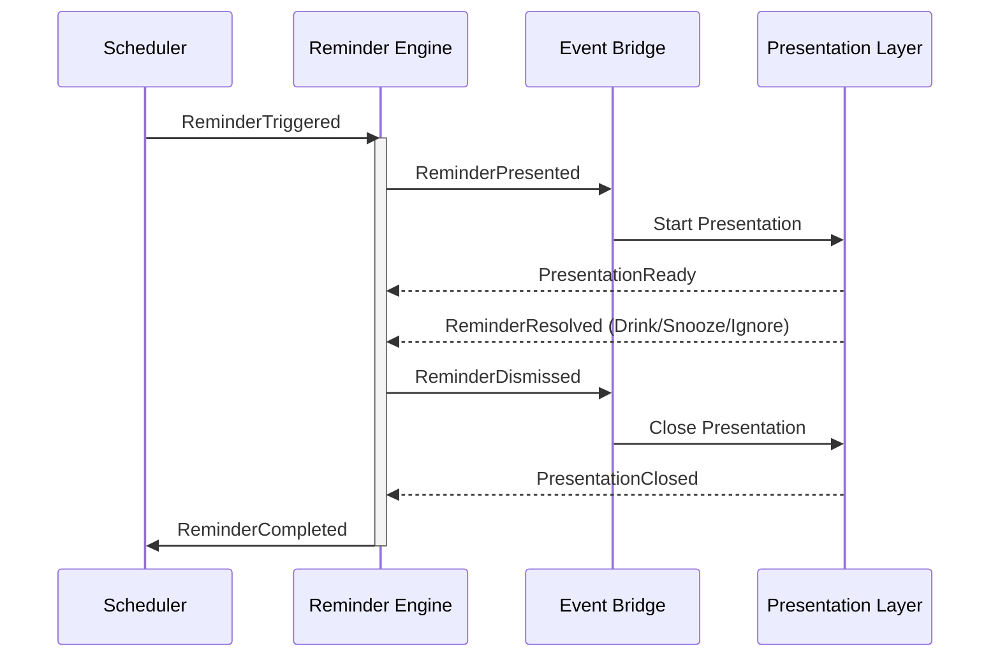

# AquaTick — Phase 8A: Reminder Experience Architecture

## 1. Reminder Experience Overview
The reminder experience begins when the Scheduler determines it is time for the user to hydrate. The Scheduler notifies the Reminder Engine, which takes over as the active authority for the session. The Reminder Engine coordinates with the Event Bridge to signal the Presentation Layer (comprising the Reminder Window, Overlay Window, Character System, and Sound System). 

The user is presented with the reminder and may interact with it (e.g., drink, snooze, or explicitly ignore). These actions are relayed back to the Reminder Engine via the Event Bridge. If the user fails to interact, the Reminder Engine enforces a timeout. Once an outcome is reached, the session resolves. The Reminder Engine then cleans up the Presentation Layer, logs the outcome with the Statistics Service, and hands control back to the Scheduler to determine the next trigger time.

## 2. Design Goals
* **Predictable behavior**: The reminder flow must be deterministic and easy to trace from end to end.
* **Single source of truth**: Only one component (Reminder Engine) holds the state of the active reminder.
* **Deterministic reminder lifecycle**: Explicit states from initiation to completion, ensuring no hanging reminders.
* **Decoupled presentation**: UI components must be completely oblivious to business logic, acting only as a reflection of state.
* **Platform consistency**: Seamless operation and reliable rendering across different OS environments.
* **Smooth user experience**: Non-intrusive, fluid transitions.
* **Architectural simplicity**: Strict hierarchical data flow avoiding circular dependencies.
* **Testability**: Clear domain boundaries to allow isolated unit testing of state transitions and UI rendering.

## 3. Ownership Boundaries

### Scheduler
* **Responsibilities**: Determining *when* a reminder should happen based on user configuration and the Activity Monitor.
* **Explicit non-responsibilities**: UI presentation, active reminder state management, enforcing timeouts.
* **Communicates with**: Reminder Engine, Activity Monitor, Settings Service.

### Reminder Engine
* **Responsibilities**: Managing the active reminder session lifecycle, enforcing timeouts, and determining the final resolution.
* **Explicit non-responsibilities**: Determining the next trigger time, rendering UI, playing audio.
* **Communicates with**: Scheduler, Event Bridge, Statistics Service.

### Event Bridge
* **Responsibilities**: Facilitating decoupled communication between the backend and frontend/external systems.
* **Explicit non-responsibilities**: State management, business logic, filtering or transforming reminder data.
* **Communicates with**: Reminder Engine, Presentation Layer.

### Reminder Window
* **Responsibilities**: Rendering the primary reminder UI and capturing user interactions.
* **Explicit non-responsibilities**: Business logic, state storage, timers.
* **Communicates with**: Event Bridge.

### Overlay Window
* **Responsibilities**: Rendering screen overlays during a reminder.
* **Explicit non-responsibilities**: Capturing input, business logic.
* **Communicates with**: Event Bridge.

### Character System
* **Responsibilities**: Rendering character visuals corresponding to the current reminder state.
* **Explicit non-responsibilities**: Initiating reminders, tracking timeouts, making business decisions.
* **Communicates with**: Event Bridge.

### Sound System
* **Responsibilities**: Playing scheduled audio cues.
* **Explicit non-responsibilities**: Timing of audio cues (dictated solely by incoming events).
* **Communicates with**: Event Bridge.

### Activity Monitor
* **Responsibilities**: Tracking user activity and reporting it.
* **Explicit non-responsibilities**: Modifying reminder state directly, scheduling.
* **Communicates with**: Scheduler.

### Statistics Service
* **Responsibilities**: Recording hydration events and calculating metrics based on outcomes.
* **Explicit non-responsibilities**: Triggering reminders, handling active session state.
* **Communicates with**: Reminder Engine.

### Settings Service
* **Responsibilities**: Providing read-only configuration data.
* **Explicit non-responsibilities**: Running timers, triggering UI updates directly.
* **Communicates with**: Scheduler, Presentation Layer.

## 4. Reminder Lifecycle & State Machine
The Reminder Session State Machine governs the exact lifecycle of a single reminder session. Every stage of the lifecycle maps directly to a state in this machine.

* **States**:
  * `Idle`: No active reminder session exists.
  * `Active`: The reminder session is actively running and waiting for interaction.
  * `Snoozed`: The reminder is temporarily paused, waiting for a snooze timer.
  * `Resolving`: An outcome has been reached, and the engine is processing logging and triggering presentation closing.
  * `Cleanup`: Finalizing session teardown before completely returning to Idle.
* **Allowed Transitions**:
  * `Idle` -> `Active` (Trigger: Scheduler initiates session)
  * `Active` -> `Resolving` (Trigger: User selects Drink, Snooze, or Ignore, OR Engine enforces Timeout)
  * `Resolving` -> `Snoozed` (Trigger: Resolution was Snooze)
  * `Resolving` -> `Cleanup` (Trigger: Resolution was Drink, Ignore, or Timeout)
  * `Snoozed` -> `Active` (Trigger: Snooze duration expires)
  * `Cleanup` -> `Idle` (Trigger: Teardown and presentation closing confirmed complete)
* **Terminal States**: `Cleanup` naturally leads to `Idle`, terminating the active session.

## 5. Ignore Behavior
The approved outcomes for a reminder are Drink, Snooze, Timeout, and Ignore.

* **Definition**: Ignore is an explicit user action (e.g., clicking a dismiss or close button) indicating they actively chose not to hydrate, whereas Timeout is an implicit outcome when the user fails to interact entirely.
* **State Representation**: Ignore is not a separate state. It is an outcome that triggers the transition from `Active` to `Resolving`.
* **Behavior Sharing**: Ignore shares the same core resolution and cleanup behavior as Timeout (the session terminates without a hydration event).
* **Impact**:
  * **Reminder Engine**: Receives the Ignore action and transitions to `Resolving`.
  * **Scheduler**: Treated as a completed session; normal scheduling rules resume.
  * **Statistics Service**: Logs the explicit "Ignore" action independently from "Timeout", preserving the distinction between active refusal and absence.

## 6. Presentation Architecture
The Presentation Layer (Reminder Window, Overlay Window, Character, Sound System) behaves conceptually as a pure, reactive view.

* **Initiation**: The Reminder Engine initiates presentation by emitting an event via the Event Bridge when entering the `Active` state.
* **Ending**: The Reminder Engine ends presentation by emitting an event when entering the `Resolving` state.
* **Synchronization & Timing**: Presentation starts simultaneously across all components upon receiving the broadcasted event. The components operate entirely independently of each other.
* **Ownership**: The Reminder Engine owns presentation synchronization as the single source of truth. The Presentation Layer does not orchestrate itself.

### Presentation State Machine
Each presentation component manages a local conceptual state machine, synchronized by the Reminder Engine's events.

* **States**:
  * `Hidden`: UI/Multimedia is entirely inactive.
  * `Preparing`: Pre-loading assets or layout before display.
  * `Showing`: Actively transitioning into view.
  * `Waiting`: Idling while awaiting user input.
  * `Resolving`: Displaying outcome feedback.
  * `Closing`: Transitioning out before becoming hidden.
* **Allowed Transitions**: `Hidden` -> `Preparing` -> `Showing` -> `Waiting` -> `Resolving` -> `Closing` -> `Hidden`.
* **Owner**: The individual presentation component (e.g., Reminder Window).
* **Relationship**: Maps to the Reminder Session State Machine. For instance, Engine `Active` triggers Presentation `Preparing` -> `Showing` -> `Waiting`. Engine `Resolving` triggers Presentation `Resolving` -> `Closing`. Engine `Cleanup` requires Presentation to reach `Hidden`.

## 7. Event Flow
* **`ReminderTriggered`**
  * **Source**: Scheduler
  * **Destination**: Reminder Engine
  * **Payload**: Timestamp
  * **Purpose**: Instruct the Reminder Engine to begin a new session.
* **`ReminderPresented`**
  * **Source**: Reminder Engine
  * **Destination**: Presentation Layer
  * **Payload**: Session ID
  * **Purpose**: Instruct all presentation components to begin their showing sequence.
* **`PresentationReady`**
  * **Source**: Presentation Layer
  * **Destination**: Reminder Engine
  * **Payload**: Component ID
  * **Purpose**: Confirm a presentation component has successfully transitioned to showing/waiting.
* **`ReminderResolved`**
  * **Source**: Reminder Window (for user action) or Reminder Engine (for timeout)
  * **Destination**: Reminder Engine
  * **Payload**: ResolutionType (Drink / Snooze / Ignore / Timeout)
  * **Purpose**: Signal an outcome has been reached.
* **`ReminderDismissed`**
  * **Source**: Reminder Engine
  * **Destination**: Presentation Layer
  * **Payload**: None
  * **Purpose**: Instruct presentation components to begin their closing sequence.
* **`PresentationClosed`**
  * **Source**: Presentation Layer
  * **Destination**: Reminder Engine
  * **Payload**: Component ID
  * **Purpose**: Confirm a presentation component is fully hidden.
* **`ReminderCompleted`**
  * **Source**: Reminder Engine
  * **Destination**: Scheduler & Statistics Service
  * **Payload**: Final Resolution Outcome
  * **Purpose**: Finalize the session, trigger statistics logging, and instruct the Scheduler to calculate the next trigger.

## 8. System Communication Diagram

## 9. Interaction Rules
* **Only one Reminder Session may exist**: The Reminder Engine will reject or queue triggers if a session is currently active.
* **Session resolution occurs exactly once**: Once the engine enters `Resolving`, subsequent user actions or timeouts are dropped.
* **Duplicate user interactions are ignored**: The engine enforces idempotency for user actions during the `Active` state.
* **Presentation failures never affect Reminder Engine state**: The engine proceeds with timeouts and logic even if a UI component fails to render or report back.
* **Scheduler never depends on presentation completion**: The scheduler calculates based on engine completion, decoupled from UI timings.
* **Presentation always reflects Reminder Engine state**: Presentation strictly reacts to events; it never assumes state changes.

## 10. Phase Dependency Roadmap
* **Phase 8B — Reminder Presentation Layer**
* **Phase 8C — Reminder Session Resolution**
* **Phase 8D — Audio & Animation Timeline**
* **Phase 8E — Edge Cases & Reliability**
* **Phase 8F — QA & Architectural Audit**

## 11. Verification Checklist
* [ ] Clear ownership defined for every participating component.
* [ ] No circular dependencies exist in system communication or data flow.
* [ ] Deterministic state transitions are fully mapped with no hanging states.
* [ ] Consistent event flow documented without ambiguity.
* [ ] Complete separation of business logic (Engine) and presentation (UI/Sound).
* [ ] Full compatibility and integration with the existing Phase 1-7 architecture.

## 12. Deferred Features
The following features are intentionally excluded from Phase 8 to prevent scope creep:
* Multi-device synchronization of active reminder states.
* Dynamic reminder intervals based on environmental factors.
* Machine-learning based optimal timing prediction.
* Custom user-uploaded sounds.
